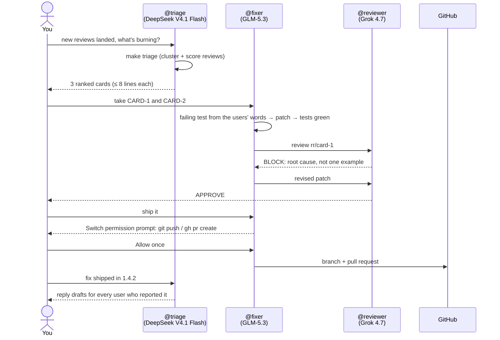

# Release Room

**A release desk for a one-person app studio, run in one Discord room by Switch.**
Three AI agents triage app-store reviews, fix the bugs behind them and review each other's work. One person holds the release lever.


Built for the [Flip the Switch hackathon](https://www.wemakedevs.org/hackathons/switch) · Track 1: Best Business Workflow

> **Demo video:** _link added on submission_ · **Blog post:** _link added on submission_

---

## The problem

I build and ship three Android apps alone: Chakuli, PyMaster and Keepary. Users report bugs in Play Store reviews: "app crashes when I scan a receipt without a date", "amounts show 100,000 not 1,00,000". Reading every review, working out which ones are the same bug, reproducing it, fixing it, getting a second opinion, shipping, then replying to the users: that's a team's job. I'm one person, so it happens late or not at all.

Release Room gives me that team in a chat channel I already have open. The agents do the legwork. I make the calls.

## How it works



All of it happens in one room: `#release-room` on Discord. Every decision ends with a `DECISION:` line, so the room history is the audit log.

## How Switch is used

Switch isn't a bot bolted onto this project. It's what makes three separate coding agents into a team you can talk to.

| Switch feature | How Release Room uses it | Without Switch |
|---|---|---|
| **Agents as named teammates** | `@triage`, `@fixer` and `@reviewer` sit in one Discord channel, each an OpenCode session on a different model | Three terminals, and I'm the message bus between them |
| **Room instructions** | The release policy (nothing ships without a person, every fix starts with a failing test, the reviewer can block) is set once on the room, and every agent follows it | The policy is copied into three prompts and drifts |
| **Shared room history** | The fixer reads the card from the room; the reviewer reads the fixer's summary | I re-explain every bug to every agent |
| **@mention handoffs** | triage → me → fixer → reviewer → me, all by @mention | I copy-paste output between tools |
| **Permission prompts in chat** | `git push` and `gh pr create` pause the fixer and post *Allow once / Allow for this session / Decline* in the channel. Switch records who approved | The agent pushes unchecked, or I write a custom approval bot |
| **Who-can-talk settings** | Agents take instructions only from me and my other agents (`owner-agents`) | Anyone in the server could drive my agents |
| **Templates** | [`switch/release-room.template.yaml`](switch/release-room.template.yaml) creates all three agents, the room, its instructions and a kickoff message in one import | Twenty minutes of clicking per person who tries it |

**Remove Switch and this stops working:** there's no room for the agents to share, no permission prompt to hold the push, and no handoffs. It's three agents in three terminals again.

### The human gate, concretely

The gate is OpenCode's own permission system, surfaced by Switch. The fixer's [`agents/fixer/opencode.json`](agents/fixer/opencode.json) marks pushing and PRs as `ask`:

```json
"bash": { "*": "allow", "git push *": "ask", "gh pr *": "ask", "rm -rf *": "deny" }
```

The fixer runs with Switch's Auto mode **off**, so an `ask` becomes a prompt in the channel rather than an automatic yes. The reviewer and triage agents can't push at all: their configs `deny` it, and their edit permission is denied too.

| Agent | Model (OpenCode) | Can edit | Can commit | Can push / open PR |
|---|---|---|---|---|
| triage | `nebius/deepseek-ai/DeepSeek-V4.1-Flash-1017` | no | no | no |
| fixer | `nebius/zai-org/GLM-5.3` | yes | yes | **asks you in chat** |
| reviewer | `xai/grok-4.7` | no | no | no |

The reviewer runs on a different model family from the fixer, so the check is independent. Models are template parameters; swap any of them on import.

## What's in the repo

| Path | What it is |
|---|---|
| `switch/release-room.template.yaml` | Switch template: 3 agents, the room, room instructions, kickoff |
| `agents/<role>/opencode.json` | Per-agent permissions (the human gate lives here) |
| `tools/` | Deterministic helpers the agents call. The agents decide; these compute |
| `tools/ingest.py` | Reads a Play Console review export (UTF-16 aware) or the sample CSV. Drops reviewer names, masks emails and phone numbers |
| `tools/cluster.py` | Groups reviews about the same problem: TF-IDF and agglomerative clustering, deterministic |
| `tools/score.py` | Severity = count × (6 − mean stars) × recency (14-day half-life) |
| `tools/cards.py`, `tools/triage.py` | Renders ranked cards of 8 lines or fewer, and writes `data/out/cards.md` and `clusters.json` |
| `tools/replies.py` | Reply drafts within Play's 350-character limit. Drafts only; a person approves them |
| `data/reviews.synthetic.csv` | 66 synthetic reviews (generated by `tools/make_sample.py`, seed 42). No real users |
| `tests/` | 28 tests: ingest, PII masking, clustering purity, scoring, cards, replies |
| [`release-room-demo-app`](https://github.com/bhanu-dev82/release-room-demo-app) | The app the agents fix: Keepary's receipt-parsing core, with three bugs that match the reviews |

## Quickstart

You need: [Switch Console](https://docs.switchagents.ai/switch-rooms/getting-started/install-switch-console) 0.40+ with Docker, [uv](https://docs.astral.sh/uv/), git, the GitHub CLI (`gh`), and OpenCode **1.x** signed in to the model providers you'll use.

> **OpenCode version:** Switch 0.40 supports OpenCode 1.x only. OpenCode 2.x fails Switch's sign-in check ([switch#1421](https://github.com/sandbox-quantum/switch/issues/1421)). `npm install -g opencode-ai@1` works, as does a separate 1.x install set as Switch's OpenCode path (Settings → Agent providers → OpenCode → Change source → Path Override).

**1. Clone and check**
```bash
git clone https://github.com/bhanu-dev82/release-room && cd release-room
make setup && make test        # 28 passed
make triage                    # 66 reviews · 3 cards
```

**2. Give the agents their own copies of the demo app.** Fork [`release-room-demo-app`](https://github.com/bhanu-dev82/release-room-demo-app) first if you want the fixer's PRs to land in your account.
```bash
make demo-data DEMO_APP_REPO=https://github.com/<you>/release-room-demo-app.git
```

**3. Start Switch.** In Switch Console: *Add a server* → *Run a server on this computer*. For chat, either:
- use the **Mattermost** that Switch starts for you (no setup), or
- connect **Discord** ([Switch's Discord guide](https://docs.switchagents.ai/switch-rooms/deploy/messaging-apps/discord)), which is what the demo uses.

**4. Import the template.** In Switch Console → *Templates*, add [`switch/release-room.template.yaml`](switch/release-room.template.yaml). Set **Absolute path of your release-room clone** to the output of `pwd`, and pick your chat app. This creates `@triage`, `@fixer`, `@reviewer` and `#release-room`, then posts the kickoff.

**5. Run the desk.** In `#release-room`:
```
@triage new reviews landed, what's burning?
```
Then assign cards to `@fixer`, and approve the push when Switch asks.

Start over at any time with `make reset`. It deletes `workspace/`, including any unpushed agent work, and rebuilds it.

### Use your own reviews

Download them from Play Console (*Ratings and reviews* → download), then:
```bash
make triage REVIEWS_CSV=path/to/reviews.csv
```
Reviewer names are dropped on read, and emails and phone numbers in review text are masked.

## Tests

```bash
make test     # 28 tests
make check    # tests + a scan for tracked secrets
```
The clustering tests check that the synthetic complaints form exactly the three bug clusters, each at least 90% pure, and that the result is deterministic.

## Limitations and what's next

- The reviews in the demo are synthetic, written to match the demo app's three bugs. The pipeline also reads real Play Console exports.
- Triage runs when someone asks. A scheduled Discord message or webhook can trigger it daily; Switch supports that.
- Reply drafts aren't posted to Google Play automatically. That needs the Play Developer API and a service account, and it stays behind a person's approval.
- Next: a Play Developer API connector for ingest and replies, and crash clusters from Firebase Crashlytics alongside reviews.

## License

MIT. See [LICENSE](LICENSE). Switch is © SandboxAQ, under its own license. OpenCode and the models are used under their providers' terms.
